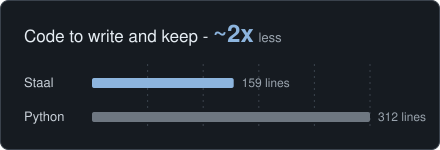
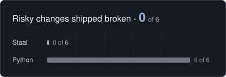

<p align="center">
  <picture>
    <source media="(prefers-color-scheme: dark)" srcset="site/brand/staal-mark-dark.svg">
    
  </picture>
</p>

<h1 align="center">Staal</h1>

<p align="center">
  <b>The programming language for agents.</b><br>
  A statically typed language whose compiler and runtime enforce what a program may do:<br>
  capabilities granted per run, validated model output, bounded model use and journaled actions.
</p>

<p align="center">
  <a href="LICENSE"></a>
  <a href="https://pypi.org/project/staal/"></a>
  <a href="https://www.npmjs.com/package/@staal/node"></a>
  <a href="https://github.com/laurells/staal"></a>
</p>

Staal is a statically typed language for the code an AI agent runs to act: moving
money, sending messages, changing files and records, and calling models. This
repository holds `staalc`, its compiler and reference runtime, written in Rust.
("Staal" is Dutch and Afrikaans for steel, said "stahl".)

Enforcement happens twice:

- **Before a run**, the compiler refuses a program that acts without a capability,
  widens one, uses model output without validating it, puts untrusted text in a
  model's instruction, can exceed its model budget, calls a model in an unbounded loop,
  lets blinded data reach a model, or claims completion without evidence (E001 to
  E008).
- **During a run**, a broker enforces the limits the application granted (`only`,
  `uses`, `each`, `max`) before each action, and a journal records every external
  effect, so a crashed run resumes without repeating an action that may already have
  happened.

Your application stays in the languages it uses now. Staal holds the part that acts
on the world, and your application grants each run what it may do.

## Install

```sh
pip install staal              # Python package, with the staalc command
npm install @staal/node        # Node.js package (no staalc command)
curl -fsSL https://raw.githubusercontent.com/laurells/staal/main/install.sh | sh
```

`install.sh` downloads the latest release for the machine, refuses it unless its
SHA-256 matches the release's checksum file, unpacks it into `~/.staal`, and links
`staalc` into `~/.local/bin`. Releases are built for Linux on x86_64 and arm64 (glibc
2.28 or later) and macOS on Apple Silicon (11 or later) and Intel (10.12 or later).
Building from source needs Rust 1.89 or later; see [Install](docs/get-started/install.md).

## Quick start

`refund.staal` moves the money:

```staal
// Refunds an order, never by more than the app allows.
fn main(order: Text, amount: Money, pay: cap payments.refund(each: 500 USD)) -> Text {
    let receipt = pay.refund(order, amount)
    return "Refunded " + to_text(amount) + " for order " + order
}
```

`app.py` grants each run a limit from the customer's tier:

```python
import staal

lib = staal.Library()
LIMIT = {"gold": 500, "standard": 50}  # USD per refund, decided by the app

def refund(tier, order, amount):
    return lib.run("refund.staal", {
        "entry": "main",
        "inputs": {"order": order, "amount": {"amount": amount, "currency": "USD"}},
        "grants": {"pay": {"cap": "payments.refund", "each": {"amount": str(LIMIT[tier]), "currency": "USD"}}},
    })

print(refund("standard", "4417", "35.00")["result"])
print(refund("standard", "4417", "300.00")["failure"]["message"])
```

```text
Refunded 35.00 USD for order 4417
'payments.refund' allows at most 50.00 USD per action; this action needs 300.00 USD
```

The tier comes from the application's records, never from the model. A grant above
the code's `each: 500 USD` is narrowed to it. With no payment service configured, the
runtime uses a simulated one, so no account or key is needed. Both files, and the same
app in Node.js, are in [examples/quickstart](examples/quickstart/), and the test suite
checks this output.

Next: [Your first program](docs/get-started/first-program.md), then [Your first
agent](docs/get-started/first-agent.md).

## Documentation

[docs/README.md](docs/README.md) indexes every page: getting started, a guide per
topic, the reference (command line, error codes, run config, language, standard
library), and the specifications ([RUNTIME.md](docs/RUNTIME.md),
[MCP.md](docs/MCP.md), [AGENT_MANIFEST.md](docs/AGENT_MANIFEST.md),
[GRAMMAR.md](docs/GRAMMAR.md)). [GUARANTEES.md](docs/GUARANTEES.md) states each
guarantee, what it depends on, how it is tested and where it stops.

## What is built

- The compiler and the eight safety rules; the reference interpreter and a native
  engine (Cranelift) with identical results, logs and journals; standalone executables
  (`staalc build`, Linux only).
- Exact decimal money with currencies; failures, not wrong answers, on overflow,
  division by zero, mixed currencies and out-of-range indexes; a maximum length on
  every list.
- Model calls to Claude, with budgets checked at compile time (E004) and charged from
  the usage the API reports.
- The runtime's own capabilities: HTTP, files, TCP and TLS, SQLite (Linux only) and
  PostgreSQL. Capabilities declared by libraries, written in Staal.
- Crash-safe journaled runs, `staalc resume` and `staalc resolve`.
- Packages fetched from git, locked by hash, with versions, registries and declared
  authority (E108).
- C library calls, contained in a seccomp-restricted worker on Linux; a run that loads
  one uncontained is marked unchecked.
- `parallel`, modules, enums and `match`, optional values, tuples, maps and sets, typed
  errors, methods, generic functions, interfaces, function values and closures, and a
  standard library.
- Hosting: the C interface (`include/staal.h`), Python and Node.js packages, tools for
  the OpenAI Agents SDK, LangGraph, the Vercel AI SDK, the Claude Agent SDK and Google
  ADK, an MCP server (`staalc mcp`, tested against the official Python and TypeScript
  SDKs), and agent folders (`staalc agent`).
- Developer tools: `fmt`, `test`, `doc`, `repl`, `debug`, `profile`, `lsp`, and a
  [VS Code extension](editors/vscode).

Not built: other model providers; Windows; `staalc build` and SQLite outside Linux;
an agent registry; runs against the live services (Claude, Termii, Stripe, Resend,
Slack) with real keys, which are tested against local stand-ins; and an independent
security review. [DEFERRED.md](docs/DEFERRED.md) lists work decided on and put off.

Staal is a preview. Before 1.0, a minor version may change the language or its file
formats; the [changelog](CHANGELOG.md) says when one does.

## Benchmark

<p align="center">
  <a href="bench/agent"></a>
  <a href="bench/agent"></a>
</p>

[bench/agent](bench/agent) builds one support agent twice, in Python alone and in
Python with Staal, to the same specification: a model reads a ticket and proposes at
most one refund (through a simulated Stripe) and one email, under the same limits,
permissions, retries and crash recovery. Both face 47 scenarios: policy, prompt
injection, malformed model output, permission escalation, failing services, lost
answers, and crashes before and after every external call. A scenario passes when
the simulated world ends with effects the scenario allows and no rule is broken.

| Metric | Python alone | Python with Staal |
| --- | --- | --- |
| Scenarios passed | 47 of 47 | 47 of 47 |
| Code to write and keep | 312 lines | 159 lines |
| Risky later changes that shipped broken | 6 of 6 | 0 of 6 |
| Operator interventions (emails in doubt) | 4 | 4 |

Lines are neither blank nor comments; the shared scenarios and simulated world are
not counted. The Python version's 312 lines include its own journal (78), request
tracking (20), model calling and checking (60), and policy and actions (82). The Staal
version's 159 are the agent (39), the app's grants and run, resume and resolve (59),
and Stripe and mail libraries (61) that a team would take from packages.

The six later changes, applied identically to both:

| Change | Python alone | Python with Staal |
| --- | --- | --- |
| Put the ticket into the model's instruction | Ships; all 47 scenarios break the rule | Refused before running (E006) |
| Drop validation of the model's plan | Ships; 4 scenarios act on malformed plans, 1 crashes | Refused before running (E001) |
| Ask the model again to polish the email | Ships; 24 scenarios exceed the budget | Refused before running (E004) |
| Log every request, headers included | Ships; API keys land in the log | Refused before running (E101) |
| Move each step into its own helper | Ships; two refunds go through where one is allowed | Runs; the limits hold |
| Resend the email if the mail service fails | Ships; a customer is emailed twice when an answer is lost | Runs; the limits hold |

Limits of the measurement: it is one agent, one specification and six changes. One
person wrote both versions knowing the scenarios, which favours the Python version.
Careful Python meets the specification on the day it is written; the benchmark
measures how much code must stay right for that to hold as the code changes. Three
control changes to the business rules, such as raising a limit, come out the same in
both, since neither can tell what the business meant. CI does not run the benchmark;
the results are in `bench/agent/results/`.

## Development

```sh
cargo test --features failpoints     # every test, with crash injection
cargo test --no-default-features     # without the native engine
cargo clippy --all-targets --features failpoints -- -D warnings
scripts/audit.sh                     # dependency advisories (needs network)
```

Every change is tested in full locally before it is merged. GitHub Actions runs the
same suite on Linux (x86_64, arm64) and macOS (Apple Silicon, Intel) for each release
tag. `tests/fixtures/pass/` holds programs that must compile and `tests/fixtures/fail/`
programs that must be rejected, each beginning `// expect: CODE`.
[CONTRIBUTING.md](CONTRIBUTING.md) says what a change needs;
[fuzz/README.md](fuzz/README.md) covers the fuzzers.

| Path | Contents |
| --- | --- |
| `src/lexer.rs`, `parser.rs`, `ast.rs` | Source text to syntax tree |
| `src/checker.rs`, `budget.rs` | Type and safety rules, worst-case model cost |
| `src/modules.rs`, `packages.rs`, `semver.rs` | Modules, manifests, `staal.lock`, fetching |
| `src/pattern.rs`, `targets.rs` | `only` patterns and canonical targets |
| `src/interp/` | The runtime: interpreter, money, broker, journal, HTTP, files, sockets, databases, C calls, model providers |
| `src/native.rs` | The native engine |
| `src/capi.rs`, `include/staal.h` | The C interface |
| `src/host/`, `src/mcp/`, `src/agent/` | The tool host, the MCP server, agent folders |
| `src/cli.rs`, `main.rs` | The command line and built executables |
| `python/`, `node/` | The Python and Node.js packages |
| `docs/` | Documentation |
| `examples/`, `packages/` | Example programs; reference packages and a template |
| `bench/agent/` | The benchmark |
| `site/` | The landing page, published to GitHub Pages |
| `tests/` | Fixtures, runtime cases, crash, engine and documentation tests |

The reference packages are also published as their own repositories:
[staal-sms](https://github.com/laurells/staal-sms),
[staal-payments](https://github.com/laurells/staal-payments),
[staal-email](https://github.com/laurells/staal-email) and
[staal-chat](https://github.com/laurells/staal-chat).

## License

Copyright 2026 Laurels Ozy Echichinwo. Licensed under the [Apache License 2.0 with
LLVM Exceptions](LICENSE) (`Apache-2.0 WITH LLVM-exception`). The exceptions mean an
executable made by `staalc build`, which contains parts of the runtime, needs no
attribution, and that the code can be combined with GPLv2 software. Contributions are
made under the same terms. The licence grants no right to the name "Staal".
