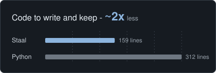
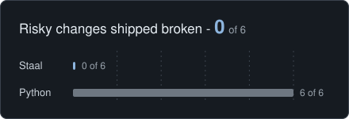

<p align="center">
  <picture>
    <source media="(prefers-color-scheme: dark)" srcset="site/brand/staal-mark-dark.svg">
    
  </picture>
</p>

<h1 align="center">Staal</h1>

<p align="center">
  <b>The programming language for agents.</b><br>
  Not a wrapper around your prompts. A language whose compiler and runtime enforce what an agent may do,<br>
  putting permissions, spending limits and crash recovery in the language instead of in code you have to keep right.
</p>

<p align="center">
  <a href="LICENSE"></a>
  <a href="https://pypi.org/project/staal/"></a>
  <a href="https://www.npmjs.com/package/@staal/node"></a>
  <a href="https://github.com/laurells/staal"></a>
</p>

<p align="center">
  <a href="bench/agent"></a>
  <a href="bench/agent"></a>
</p>

## Benchmarks

The same support agent, built twice: in Python alone and in Python with Staal, with
the same limits, permissions, retries and crash recovery. A model reads a ticket and
proposes at most one refund (through a simulated Stripe) and one email. Both versions
face 47 scenarios: policy, prompt injection, malformed model output, permission
escalation, failing services and lost answers, and crashes before and after every
external call. A scenario passes when the effects the simulated world ends up with
are ones the scenario allows and no rule of the specification broke.

| Metric | Python alone | Python with Staal |
| --- | --- | --- |
| Attack and crash scenarios passed | 47 of 47 | 47 of 47 |
| Code to write and keep | 312 lines | 159 lines |
| Risky later changes that shipped broken | 6 of 6 | 0 of 6 (4 refused before running, 2 held at run time) |
| Operator interventions (emails in doubt) | 4 | 4 |

Code is counted as lines that are neither blank nor comments. Neither version has
tests of its own; the 47 scenarios and the simulated world are shared and not
counted. The Python version's 312 lines are one file that holds, among the rest, its own journal (78 lines), deciding
whether a request was sent (20), calling and checking the model (60), and the policy
and actions (82). The Staal version's 159 are the agent (39), the app's grants, run,
resume and resolve (59), and the Stripe and mail libraries (61), which a team would
take from packages, leaving 98.

The six later changes, made identically to both versions:

| Change | Python alone | Python with Staal |
| --- | --- | --- |
| Put the ticket into the model's instruction | ships; all 47 scenarios break the rule | refused before it runs (E006) |
| Drop validation of the model's plan | ships; 4 scenarios act on malformed plans, 1 crashes the job | refused before it runs (E001) |
| Ask the model again to polish the email | ships; 24 scenarios go over the budget | refused before it runs (E004) |
| Log every request, headers included | ships; the API keys land in a log | refused before it runs (E101) |
| Refactor each step into its own helper | ships; two refunds go through where one is allowed | runs; the limits still hold |
| Resend the email if the mail service fails | ships; a customer is emailed twice when an answer is lost | runs; the limits still hold |

This is one agent, one specification and six changes. Both versions were written by
one person who knew the scenarios in advance, which favours the Python version. Careful Python can meet
the same specification, and on the day it is written it does. What the benchmark
measures is how much code has to stay right for those guarantees to hold as the
system changes. Three control changes, to the policy or the order of business (for
example raising a limit), come out the same in both versions, because neither
language can tell what the business meant. [bench/agent](bench/agent) has the code, every scenario, the
controls and the rest of what this does not show.

## What it is

Agents should not act on prompts and hope. Staal is a programming language built
for what agents do: moving money, sending messages, changing files and records,
and calling AI models.

The work is split in two. Before a program runs, the compiler checks that it follows
the language's safety rules: every action has a capability in scope, no capability is
widened, a model's output is validated before it is used, untrusted text never
becomes a model's instruction, and model use cannot exceed its declared budget. While
it runs, the capability broker enforces the permissions and limits your application
actually granted, and a journaled run records every external effect, so after a
crash it resumes without blindly repeating a payment or a message.

Staal is said "stahl": it is Dutch and Afrikaans for steel. This repository holds
`staalc`, the Staal compiler and reference runtime, written in Rust.

## Where Staal fits

You do not build your application in Staal. Your API, frontend, database layer and
business logic stay in the languages and frameworks you use now. Staal is for the
paths where an AI agent takes actions with consequences: a support agent that issues
refunds, an agent that sends SMS, email or Slack messages, one that changes records in
PostgreSQL or SQLite or files on disk, or one that calls any HTTP API through a
library capability. Your application decides what each run may do; Staal checks the
program and enforces those permissions while it runs.

## Quick start

Keep your app in Python or Node.js; write the part that moves money or messages in
Staal. Your app decides the policy, Staal enforces it:

    pip install staal            # or: npm install @staal/node

`refund.staal`, the part that moves money:

```
// Refunds an order, never by more than the app allows.
fn main(order: Text, amount: Money, pay: cap payments.refund(each: 500 USD)) -> Text {
    let receipt = pay.refund(order, amount)
    return "Refunded " + to_text(amount) + " for order " + order
}
```

`app.py`, your app, granting each run a limit by customer tier:

```python
import staal

lib = staal.Library()
LIMIT = {"gold": 500, "standard": 50}  # USD per refund, decided by your app

def refund(tier, order, amount):
    return lib.run("refund.staal", {
        "entry": "main",
        "inputs": {"order": order, "amount": {"amount": amount, "currency": "USD"}},
        "grants": {"pay": {"cap": "payments.refund", "each": {"amount": str(LIMIT[tier]), "currency": "USD"}}},
    })

print(refund("standard", "4417", "35.00")["result"])
print(refund("standard", "4417", "300.00")["failure"]["message"])
```

```
Refunded 35.00 USD for order 4417
'payments.refund' allows at most 50.00 USD per action; this action needs 300.00 USD
```

The tier comes from your application's own records, such as the signed-in
customer's account, never from the model. This example shows capability enforcement
only; to make a run crash-safe, give it a journal
(`lib.run(..., journal="refund-4417.journal")`), and a crashed run then continues with
`lib.resume`.

No account or key is needed: with no payment service configured, Staal uses a
simulated one. The same in Node.js, and both files in full, are in
`examples/quickstart/`; the test suite checks this output. Next, the
[tutorial](docs/TUTORIAL.md) adds a model's decision, and the guide's "Policy from
your app" shows the pattern in depth.

## Highlights

**Safety checked at compile time.** Eight rules (E001 to E008) reject a program
that would act without a capability, widen a capability, use a model's output
without validating it, let untrusted text instruct a model, exceed a model
budget, call a model inside an unbounded loop, leak data marked as blinded to a
model, or claim completion without evidence.

**Authority you can read.** An action needs a capability in scope, and the
capability's limits (`only`, `uses`, `each`, `max`) are enforced by a broker
before the action runs. A package declares the authority it needs in its
manifest, and the compiler refuses code that reaches beyond it.

**Exact money, bounded everything.** Money is a decimal with a currency, never
floating point. Overflow, division by zero, mixed currencies and out-of-range
indexes are failures, not wrong answers. Every list declares a maximum length.

**Bounded model use.** A function declares a budget of model calls and tokens
(`budget(calls: 1, tokens: 400)`). The compiler refuses a function whose worst-case
use can exceed it (E004) and a model call inside an unbounded loop (E005). At run
time, a call that the remaining budget cannot cover is refused before it is sent, and
the budget is charged from the usage the provider reports. Untrusted data is sent to
the model in a section marked as data, never as its instruction (E006), data marked
blinded never reaches a model (E007), and a model's output is a `Proposed` value
that must pass `validate` before it can reach an action (E001).

**Crash recovery built into the runtime.** A journaled run (`--journal`, or
`journal=` from Python and Node.js) records every external effect before it happens
and after its outcome is known. If the process crashes, the run resumes from the
journal without repeating anything whose outcome it recorded. When an action may
have happened but its outcome was not recorded, it is never guessed: an action the
service deduplicates by key is made again on resume with the same idempotency key,
so the service returns its original result, and any other action stops the run until
an operator records what happened (`staalc resolve`).

**Native code and standalone executables.** Pure functions compile to machine
code through Cranelift, with results, errors and journals identical to the
interpreter. `staalc build` links a program into a single executable.

**Callable from any language.** A C interface (`include/staal.h`) runs programs
from other languages, with packages for Python (`python/`) and for Node.js and
TypeScript (`node/`): your application decides the policy, Staal enforces it
(GUIDE.md, "Policy from your app"). `staalc schema` prints the JSON Schemas of a
function's inputs and result, so a program can be described as a tool to agent
frameworks, and `staalc mcp` serves programs as tools to any Model Context Protocol
client, with each call an ordinary run under the grants the operator's manifest gives,
plus quotas across calls and `once` for calls that must not run twice
([docs/MCP.md](docs/MCP.md)). The same tools run inside an app (`staal.Tool` in
Python, `Tool.open` in Node.js), with grants your app computes for each call, and as
tools of the OpenAI Agents SDK, LangGraph and the Vercel AI SDK ([examples/frameworks](examples/frameworks)).

**An explicit boundary with native code.** A program can call C libraries, granted
by the library's SHA-256 and each function's exact signature. Staal cannot check what
C code does, so every run granted a C function is marked unchecked: in its log, on
the command line and in the C interface's result. The guarantees above end at that
boundary, and Staal says so where it applies.

## A first program

```
type Line { item: Text, price: Money, qty: Int }

fn line_total(line: Line) -> Money {
    return line.price * line.qty
}

fn total(lines: List<Line, 20>) -> Money {
    let sum = 0.00 NGN
    for line in lines {
        set sum = sum + line_total(line)
    }
    return sum
}
```

```
$ staalc run examples/invoice/invoice.staal --config examples/invoice/run.json
{"amount":"187501.50","currency":"NGN"}
```

The [language guide](docs/GUIDE.md) covers capabilities, models, budgets,
evidence, modules, packages and the rest.

## Getting started

Without Rust, from a release, on Linux (x86_64 or arm64) or macOS:

```
curl -fsSL https://raw.githubusercontent.com/laurells/staal/main/install.sh | sh
```

[install.sh](install.sh) downloads the latest release's archive for your machine,
refuses it unless its SHA-256 matches the release's, unpacks it into `~/.staal`, and
links `staalc` into `~/.local/bin`. Or unpack the archive yourself and run its
`staalc`, or install the wheel with `pip install staal-X.Y.Z-py3-none-<platform>.whl`,
which gives the `staalc` command and the `staal` Python package
([docs/RELEASING.md](docs/RELEASING.md) says what a release holds). Releases are
made for Linux on x86_64 and arm64 (glibc 2.28 and later) and macOS on Apple
Silicon (11 and later) and Intel (10.12 and later); arm64 Linux from 0.24.0.

From source: Rust 1.89 or newer ([rustup.rs](https://rustup.rs)), `git` to
fetch packages, and a C compiler (`cc`) to build executables. Developed and
tested with Rust 1.97.0.

```
git clone https://github.com/laurells/staal.git
cd staal
cargo build --release
./target/release/staalc check examples/invoice/invoice.staal
./target/release/staalc run examples/invoice/invoice.staal --config examples/invoice/run.json
```

To build without the native compiler (smaller, interpreter only):
`cargo build --release --no-default-features`.

## Command line

| Command | What it does |
| --- | --- |
| `staalc check <file.staal>` | Checks a program and reports errors by code |
| `staalc run <file.staal> [--entry <fn>] [--input <name>=<value>]...` | Runs a program that needs no grants, from the command line |
| `staalc run <file.staal> --config <run.json>` | Runs a program with the inputs, grants and model a run config gives; add `--journal` for crash-safe runs and `--engine native` for native code |
| `staalc config <file.staal> [--entry <fn>]` | Prints a run config to fill in for a program |
| `staalc schema <file.staal> [--entry <fn>]` | Prints the JSON Schemas of a function's inputs and result, for describing it as a tool |
| `staalc mcp <manifest.json>` | Serves programs as tools to MCP clients, on standard input and output ([docs/MCP.md](docs/MCP.md)) |
| `staalc mcp status <manifest.json>` | Lists a server's unfinished runs and each tool's quota use |
| `staalc resume <file.staal> --config <run.json> --journal <run.journal>` | Continues a run that stopped or crashed |
| `staalc resolve --journal <run.journal> ...` | Records an operator's decision on an action left in doubt |
| `staalc fetch [<project folder>]` | Fetches the packages named in `staal.json` and writes `staal.lock` |
| `staalc update [<project folder>] [--package <name>]` | As fetch, moving locked versions to the newest within their ranges |
| `staalc publish --registry <folder> --git <location> --commit <id>` | Adds a package version to a registry |
| `staalc yank --registry <folder> --package <name> --version <v> [--undo]` | Marks a published version not to be chosen again |
| `staalc build <file.staal> -o <app>` | Builds a standalone executable (Linux) |
| `staalc fmt [--check] <file.staal>...` | Formats files in place, or lists those not formatted |
| `staalc test [--config <test.json>] <file or folder>...` | Runs the tests written in Staal, in both engines |
| `staalc doc <file.staal> [-o <out.md>]` | Writes the program's documentation in Markdown |
| `staalc repl` | Runs Staal one input at a time |
| `staalc profile <file.staal> --config <run.json>` | Runs a program and shows what each function spent |
| `staalc debug <file.staal> --config <run.json>` | Runs a program, stopping at breakpoints and steps |
| `staalc lsp` | A language server for editors: the same errors as `check`, completion, formatting |

Exit codes: `0` success; `1` check errors or a failed run; `2` a usage, file,
config or journal problem (nothing was run); `3` the run stopped and can be
continued.

## Documentation

| Document | Contents |
| --- | --- |
| [docs/TUTORIAL.md](docs/TUTORIAL.md) | Staal in one hour: from install to a program that sends messages and asks a model |
| [docs/GUIDE.md](docs/GUIDE.md) | The language: rules, syntax, capabilities, packages, native code |
| [docs/RUNTIME.md](docs/RUNTIME.md) | The runtime specification: semantics, the journal, failure behaviour |
| [docs/MCP.md](docs/MCP.md) | `staalc mcp`: the manifest, the protocol, quotas, `once`, crashes and operators |
| [docs/PACKAGES.md](docs/PACKAGES.md) | Write your first Staal package: one service, from an empty folder to passing tests |
| [docs/RELEASING.md](docs/RELEASING.md) | How a release is made, and what it holds |
| [editors/vscode](editors/vscode) | The VS Code extension: highlighting and the language server |
| [docs/GRAMMAR.md](docs/GRAMMAR.md) | The complete syntax, checked against the parser by the tests |
| [examples/README.md](examples/README.md) | Programs that call Claude and send real SMS and email, and how to run them with your keys |
| [packages/README.md](packages/README.md) | The packages, the template, and how a package is tested |
| [include/staal.h](include/staal.h) | The C interface |
| [CHANGELOG.md](CHANGELOG.md) | What changed in each version |

## Status

Staal is pre-release and not yet ready for production use. Built and tested:
the compiler and all eight safety rules, the reference runtime, Claude as a
model provider, exact money, the capability broker, budgets, the crash-safe
journal, modules, HTTP, file, TCP, SQLite and PostgreSQL capabilities,
capabilities declared by libraries, packages with versions and registries, an MCP
server (`staalc mcp`, checked against the official Python and TypeScript SDKs),
fetched from git and locked by hash, native code, executables, the C interface,
and calling C libraries (runs that do are marked unchecked); enums and `match`, optional values, tuples, maps
and sets, typed errors, methods, generic functions, interfaces, function values and
closures; and a standard library of text, number, list, hashing, encoding and date
functions, with printing, the clock and random numbers journaled so a resumed run
replays them.

Platforms: CI runs the whole test suite on every change on Linux (x86_64 and arm64)
and macOS (Apple Silicon and Intel), including the Python wheel installed and used
with no Rust. Two features are Linux only so far and refuse elsewhere: `staalc build`
and the `db.sqlite` capabilities. The Node.js package's crash-injection tests run on
Linux. Releases, the PyPI wheels and the npm package cover all four platforms.

Not yet done: runs against the live services (Claude, Termii, Stripe, Resend,
Slack) with real keys, which so far are tested against local stand-ins; other
model providers; Windows; `staalc build` and SQLite outside Linux; MongoDB; and an
independent security review. docs/DEFERRED.md lists the work decided on and
put off.

## Repository layout

```
src/lexer.rs, parser.rs, ast.rs   source text to syntax tree
src/checker.rs, budget.rs         type and safety rules, worst-case model cost
src/modules.rs, packages.rs       modules, manifests, staal.lock, fetching from git
src/pattern.rs, targets.rs        `only` patterns and canonical targets
src/interp/                       reference runtime: interpreter, money, broker,
                                  journal, HTTP, files, model providers (Claude)
src/native.rs                     native code through Cranelift
src/capi.rs, include/staal.h      the C interface
src/cli.rs, main.rs               the command line and built executables' entry
python/staal/                     Python wrapper over the C interface
docs/                             language guide and runtime specification
examples/                         example programs and libraries
packages/                         packages: sms, payments, email, chat, code, messaging,
                                  and the template a new one starts from
site/                             the landing page, published to GitHub Pages
tests/                            fixtures, runtime cases, crash and engine tests
```

## Development

```
cargo test --features failpoints     # every test, with crash injection
cargo test --no-default-features     # without native code
cargo clippy --all-targets --features failpoints -- -D warnings
scripts/audit.sh                     # dependency advisories (needs network)
```

`tests/fixtures/pass/` holds programs that must compile and
`tests/fixtures/fail/` programs that must be rejected, each starting with
`// expect: CODE`. To add a rule, write the failing program first, then make the
checker reject it. CI runs every test on Linux, Apple Silicon and Intel macOS.
[CONTRIBUTING.md](CONTRIBUTING.md) says what a change needs, and
[fuzz/README.md](fuzz/README.md) how to run the fuzzers.

## Related repositories

The reference packages are also published on their own, so projects can depend
on them by git URL and commit:
[staal-sms](https://github.com/laurells/staal-sms),
[staal-payments](https://github.com/laurells/staal-payments),
[staal-email](https://github.com/laurells/staal-email) and
[staal-chat](https://github.com/laurells/staal-chat).

## License

Copyright 2026 Laurels Ozy Echichinwo. Licensed under the
[Apache License, Version 2.0, with the LLVM Exceptions](LICENSE)
(`Apache-2.0 WITH LLVM-exception`), as LLVM, Cranelift and Wasmtime are. The
exceptions mean an executable `staalc build` makes, which holds parts of the
runtime, needs no attribution, and that the code can be combined with GPLv2
software. Contributions are made under the same terms ([CONTRIBUTING.md](CONTRIBUTING.md)).
The licence grants no right to the name "Staal".
