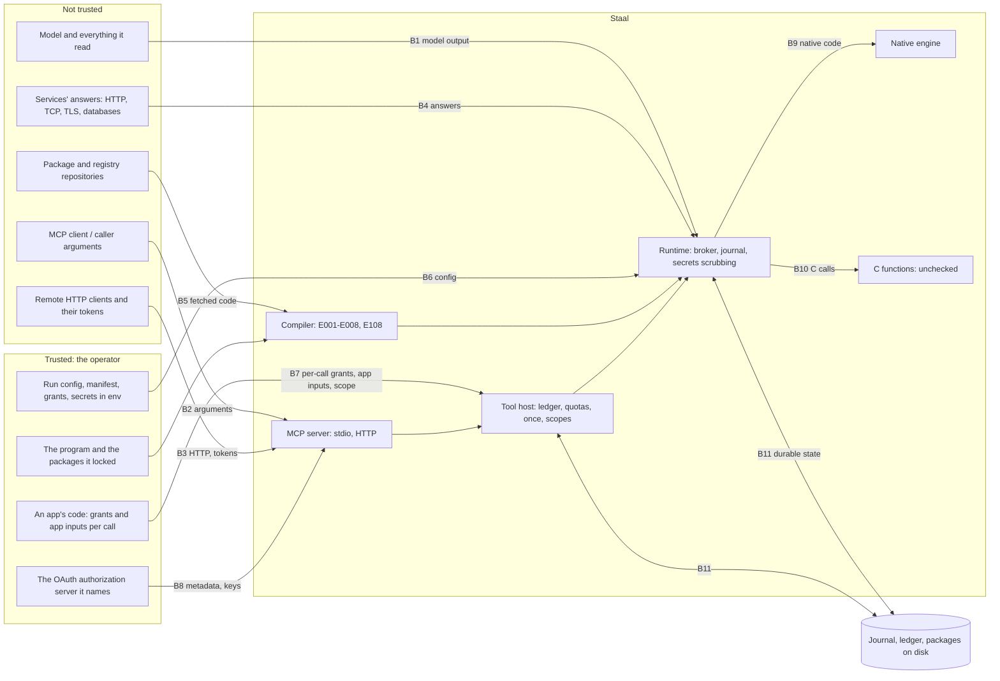

# Architecture and trust boundaries

What Staal is made of, how data moves through it, and where trust changes. The
threat model ([THREAT_MODEL.md](THREAT_MODEL.md)) is organised by the boundaries
named here (B1 to B12). Line counts are of the reviewed commit
([README.md](README.md)); the specifications are [RUNTIME.md](../RUNTIME.md),
[GUIDE.md](../GUIDE.md), [MCP.md](../MCP.md) and [PACKAGES.md](../PACKAGES.md).

## 1. What Staal is

A programming language for programs that call language models and act in the
world. Its claim is that a model's output never becomes authority: the compiler
refuses programs that would let model text act, widen a capability, become an
instruction or SQL, or call a model without bound; the runtime checks every action
against the capabilities the operator granted, journals every operation so a crash
never repeats an action blind, and keeps secrets out of everything it records. The
guarantees, with what each depends on and the tests that check it, are in
[GUARANTEES.md](../GUARANTEES.md).

## 2. Components

All Rust, in one crate (`staalc`, edition 2024, MSRV 1.89), built as the `staalc`
binary, `libstaalc` (a C dynamic and static library) and the Rust library the other
targets link.

| Component | Rust lines | Files |
| --- | ---: | --- |
| Compiler (front end and safety checks) | 10,021 | `src/lexer.rs`, `src/parser.rs`, `src/ast.rs`, `src/checker.rs`, `src/modules.rs`, `src/budget.rs`, `src/calls.rs`, `src/aliases.rs`, `src/consts.rs`, `src/pattern.rs` |
| Interpreter and runtime core | 6,532 | `src/interp/mod.rs`, `src/interp/value.rs`, `src/interp/money.rs`, `src/interp/time.rs`, `src/interp/broker.rs`, `src/runconfig.rs`, `src/targets.rs`, `src/clip.rs` |
| Journal (durability, recovery) | 1,003 | `src/interp/journal.rs` |
| Runtime capabilities (network, files, databases) | 2,409 | `src/interp/http.rs`, `src/interp/tcp.rs`, `src/interp/fsx.rs`, `src/interp/db.rs`, `src/interp/pg.rs` |
| Model providers and adapters | 932 | `src/interp/anthropic.rs`, `src/interp/provider.rs`, `src/interp/adapter.rs` |
| C functions (`cap ffi`) | 285 | `src/interp/ffi.rs` |
| Native engine (Cranelift JIT and AOT) | 3,022 | `src/native.rs` |
| Tool host (ledger, quotas, `once`, recovery) | 2,681 | `src/host/mod.rs`, `src/host/tool.rs`, `src/host/ledger.rs` |
| MCP server, stdio | 993 | `src/mcp/mod.rs`, `src/mcp/proto.rs`, `src/mcp/manifest.rs` |
| MCP server, HTTP and OAuth (not in a release build) | 1,865 | `src/mcp/http.rs`, `src/mcp/jwt.rs`, `src/mcp/keys.rs`, `src/mcp/principal.rs` |
| C interface | 596 | `src/capi.rs`, `include/staal.h` |
| Packages and registries | 1,869 | `src/packages.rs`, `src/semver.rs` |
| Command line and executables | 1,361 | `src/cli.rs`, `src/main.rs`, `src/lib.rs` |
| Developer tooling (REPL, LSP, formatter, docs, debugger) | 1,468 | `src/repl.rs`, `src/lsp.rs`, `src/fmt.rs`, `src/doc.rs`, `src/debug.rs` |
| Node.js addon (N-API, over the C interface) | 190 | `node/src/lib.rs` |
| **Rust total** | **35,227** | |

Outside Rust: the Python package (540 lines, `python/staal/`, loading `libstaalc`
with `ctypes`), the Node.js package's JavaScript (`node/*.js`, `node/*.mjs`), the
Staal packages in `packages/` (809 lines of Staal: the library capabilities for
payments, email, SMS, chat and others), `install.sh` (126 lines), and the release
workflows in `.github/workflows/`.

## 3. How a run works

1. **Load.** The program file, its modules and its packages are read. Packages are
   verified against `staal.lock` (every file's SHA-256) before the compiler reads
   them (`src/packages.rs`).
2. **Check.** The compiler type-checks the program and applies the safety rules
   E001 to E008 and the package authority rule E108 (`src/checker.rs`). A program
   with an error never runs.
3. **Configure.** The run config (JSON from the operator) gives the inputs, the
   grants (capabilities with their limits), secrets by environment variable name,
   the model, adapters, network and file settings, and limits
   (`src/runconfig.rs`, `src/interp/mod.rs` `Setup`). Everything is validated before
   anything runs; inputs are checked against the entry function's types.
4. **Run.** The interpreter (or, for functions that qualify, native code compiled
   with Cranelift) executes the program. Every action goes through the broker
   (`src/interp/broker.rs`), which checks it against the grant and every capability
   it was narrowed from. Every external operation (action, model call) is written to
   the journal as an intent before it is made and as a result after
   (`src/interp/journal.rs`), each record flushed with `fsync`.
5. **Resume.** A run a crash interrupted is resumed from its journal: completed
   operations are replayed without contacting anything; an operation whose intent
   has no result is in doubt, and is sent again only when it is safe to (an
   idempotency key the service deduplicates by), otherwise the run stops for an
   operator (`staalc resolve`).

## 4. Ways in

| Entry point | Who uses it | Input it reads |
| --- | --- | --- |
| `staalc run`, `resume`, `resolve`, `check`, `build`, `test`, `debug`, `profile`, `repl`, `doc`, `config`, `schema`, `fmt` | developers, operators | program files, run config, journal |
| `staalc fetch`, `update`, `publish`, `yank` | developers | `staal.json`, `staal.lock`, git repositories, registries |
| `staalc lsp` | an editor | LSP messages on standard input |
| `staalc mcp <manifest>` (stdio) | an MCP client | JSON-RPC lines on standard input |
| `staalc mcp <manifest>` with `server.http` (test builds only) | remote MCP clients | HTTP requests, access tokens |
| `staalc mcp status` | operators | the ledger |
| `libstaalc` (`include/staal.h`), Python `staal`, Node.js `@staal/node` | apps | C strings: paths, JSON configs, tool specs, arguments |
| An executable from `staalc build` | operators | its embedded program, run config, journal |
| `install.sh` | users installing | a GitHub release archive and its SHA-256 |

## 5. Trust boundaries

| Boundary | What crosses it | Trusted side's rule |
| --- | --- | --- |
| **B1** Model output to the runtime | a model's answer (`Proposed<T>`) | untrusted until `validate` (E001); never an instruction or SQL (E006); a reply over 16 MiB is refused (`src/interp/anthropic.rs`) and its shape is checked against the requested type |
| **B2** Caller to a tool | a tool name and arguments | arguments are only the entry function's inputs, checked against its types; they never become a grant, an app input, a scope or a limit |
| **B3** Network to the HTTP transport | requests, headers, bodies, bearer tokens | every request checked (Host, Origin, method, media types, sizes, headers against the body) and every token verified before anything is served |
| **B4** Services to the runtime | HTTP responses, TCP and TLS replies, rows, accepted requests | data, never authority; secrets removed; sizes and times bounded; TLS certificates verified |
| **B5** Repositories to the compiler | package source | pinned by SHA-256 per file in `staal.lock`; held to its manifest's authority (E108) |
| **B6** Operator config to the runtime | grants, limits, secrets (by env name), timeouts | trusted; validated for shape before anything runs |
| **B7** App to the tool host | per-call grants, app inputs, a scope | trusted (the app's own code); checked for shape |
| **B8** Authorization server to the HTTP transport | its metadata and signing keys | fetched over verified HTTPS without redirects, bounded, and checked field by field |
| **B9** Runtime to native code | compiled functions, a context pointer | generated code and its runtime helpers share a contract stated in `src/native.rs` |
| **B10** Runtime to C code (`cap ffi`) | arguments, a library | not checked: a run that can call C is marked unchecked |
| **B11** Process to disk | journal, ledger, waiting records, packages, principal key fingerprint | trusted: whoever can write them decides what a run replays; directories must be the process user's and not writable by others |
| **B12** Release to user | archives, wheels, npm package, `install.sh` | SHA-256 checked by `install.sh`; PyPI and npm by trusted publishing |

## 6. Durable state

| File | Written by | Holds | Integrity |
| --- | --- | --- | --- |
| Journal (`*.journal`) | a run | each operation's intent and result, the program and config hash | append-only, each record `fsync`ed; a torn last record is cut; a resume needs the same program hash (RUNTIME.md section 11) |
| `server.ledger` | the tool host | reservations, settlements, `once` keys, scopes | append-only, each event `fsync`ed before anything depends on it; a failed write poisons the ledger (`src/host/ledger.rs`) |
| `waiting/<run>.json` | the tool host | a run stopped for an operator | written atomically (temporary file, `fsync`, rename, directory `fsync`) |
| `principal-key` | the HTTP transport | the HMAC fingerprint of the principal key | written atomically |
| `staal.lock`, `.staal/packages/` | `staalc fetch` | locked packages and their files' SHA-256 | verified at every load |
| `server.lock` | the tool host | an exclusive OS file lock (`File::try_lock`): one process per journal directory | held for the process's life |

## 7. Processes and concurrency

- `staalc run` is one process; `parallel` runs tasks on up to 16 threads that share
  no mutable data (RUNTIME.md section 18).
- The tool host (behind `staalc mcp`, the C interface's tool functions, Python and
  Node.js) runs each call on its own thread, holds one mutex over the ledger, and
  takes an OS lock on its journal directory.
- The HTTP transport reads requests on a tokio runtime and hands each call to the
  same session and host as stdio; runs stay on their own threads.
- The native engine runs on the calling thread; generated code is entered only from
  the interpreter.
